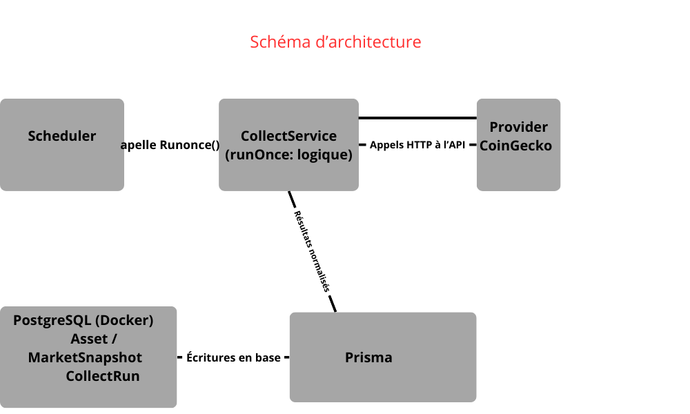

# Sprint 1 : Collecte & Stockage

1. Architecture générale du backend

L’objectif du Sprint 1 est de mettre en place un service de collecte autonome qui récupère périodiquement les données de plusieurs cryptomonnaies, les stocke dans une base PostgreSQL et trace chaque exécution de collecte.

Les composants principaux sont :

- **API backend (Express)** : expose des endpoints HTTP (`/health`, `/collect`, `/assets`, `/prices`, `/changes`).
- **Service de collecte (`CollectService`)** : contient la logique d’un run de collecte (`runOnce`).
- **Scheduler (`scheduler.ts`)** : lance `runOnce` automatiquement toutes les 60 secondes (cron).
- **Providers externes (CoinGecko)** : appel HTTP à l’API publique de CoinGecko pour récupérer les prix.
- **Accès base de données (Prisma)** : ORM utilisé pour lire/écrire dans PostgreSQL.
- **Base de données PostgreSQL (Docker)** : stocke les tables `Asset`, `MarketSnapshot` et `CollectRun`.
  
